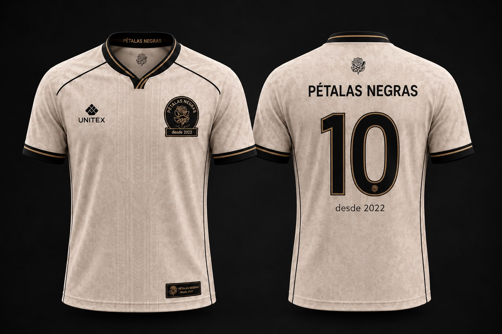

# Pétalas Negras FC: site oficial

Site do **Pétalas Negras FC**, time de futebol de várzea de Guarulhos (SP), fundado em 2022.
Mostra os jogos, o elenco com a comissão técnica, a história do time, o manto oficial (venda pelo WhatsApp) e os contatos.

Este documento explica **tudo** o que existe no projeto, como cada parte funciona e como fazer a manutenção do dia a dia, mesmo para quem nunca mexeu nele.

---

## Sumário

1. [Visão geral](#1-visão-geral)
2. [Como ver o site no seu computador](#2-como-ver-o-site-no-seu-computador)
3. [Estrutura de pastas](#3-estrutura-de-pastas)
4. [Como o projeto funciona (a ideia central)](#4-como-o-projeto-funciona-a-ideia-central)
5. [Páginas do site](#5-páginas-do-site)
6. [Tarefas do dia a dia (passo a passo)](#6-tarefas-do-dia-a-dia-passo-a-passo)
   - [Cadastrar um jogo](#61-cadastrar-ou-alterar-um-jogo)
   - [Lançar o placar de um jogo](#62-lançar-o-placar-de-um-jogo)
   - [Cadastrar um jogador](#63-cadastrar-um-jogador)
   - [Atualizar jogos, gols e assistências](#64-atualizar-jogos-gols-e-assistências)
   - [Cadastrar o técnico ou a comissão técnica](#65-cadastrar-o-técnico-ou-a-comissão-técnica)
   - [Trocar fotos e imagens](#66-trocar-fotos-e-imagens)
   - [Mudar o telefone/WhatsApp](#67-mudar-o-telefonewhatsapp)
   - [Mudar camisas e preços](#68-mudar-camisas-e-preços)
   - [Mudar textos (história, contato, início)](#69-mudar-textos-história-contato-início)
   - [Mudar as cores do site](#610-mudar-as-cores-do-site)
7. [Referência dos arquivos de dados (.csv)](#7-referência-dos-arquivos-de-dados-csv)
8. [Referência dos scripts em Python](#8-referência-dos-scripts-em-python)
9. [Referência do visual (CSS)](#9-referência-do-visual-css)
10. [JavaScript](#10-javascript)
11. [Imagens: nomes e tamanhos](#11-imagens-nomes-e-tamanhos)
12. [Como criar uma página nova](#12-como-criar-uma-página-nova)
13. [Publicar o site](#13-publicar-o-site)
14. [Problemas comuns e soluções](#14-problemas-comuns-e-soluções)
15. [Decisões de projeto e limitações](#15-decisões-de-projeto-e-limitações)
16. [Checklist de manutenção](#16-checklist-de-manutenção)

---

## 1. Visão geral

| Item | Como é |
|---|---|
| Tipo de site | **Estático**: só HTML, CSS e um pouco de JavaScript. Não tem servidor, banco de dados nem login. |
| Tema | Escuro, minimalista. Cor do clube: roxo `#732d91`. |
| Fonte | [Archivo](https://fonts.google.com/specimen/Archivo) (Google Fonts), com fontes do sistema como reserva. |
| Idioma | Português do Brasil (`lang="pt-BR"`). |
| Dados | Dois arquivos de planilha (`jogos.csv` e `elenco.csv`) na pasta `dados/`. |
| Automação | Dois scripts em Python 3 leem os `.csv` e **reescrevem** trechos do HTML. |
| Dependências | Nenhuma. Os scripts usam só a biblioteca padrão do Python (3.8 ou mais novo). |
| JavaScript no site | Só o necessário para abrir e fechar o menu no celular. |

**Em uma frase:** você edita uma planilha, roda um script, e as páginas HTML são atualizadas sozinhas.

---

## 2. Como ver o site no seu computador

Não precisa instalar nada para **ver** o site: dê dois cliques em `index.html` e ele abre no navegador.

Para **atualizar jogos ou elenco** você precisa do [Python 3](https://www.python.org/downloads/) instalado. Para conferir:

```bash
python --version
```

(Em alguns computadores o comando é `python3`. Se `python` não funcionar, use `python3` no lugar, em todos os exemplos deste documento.)

---

## 3. Estrutura de pastas

```
site/
├── index.html          Página inicial
├── jogos.html          Próximos jogos e jogos realizados
├── elenco.html         Comissão técnica e atletas, por posição
├── historia.html       História do time
├── loja.html           Manto oficial (compra pelo WhatsApp)
├── contato.html        Como marcar jogo com o time
├── 404.html            Página mostrada quando o endereço não existe
├── README.md           Este documento
│
├── css/
│   └── estilo.css      Todo o visual do site (um único arquivo)
│
├── js/
│   └── menu.js         Abre/fecha o menu no celular (único JavaScript)
│
├── dados/              O "banco de dados" e os scripts que atualizam o site
│   ├── jogos.csv           Histórico e calendário de jogos
│   ├── elenco.csv          Jogadores, estatísticas e comissão técnica
│   ├── atualizar_jogos.py  Lê jogos.csv e reescreve jogos.html e index.html
│   └── atualizar_elenco.py Lê elenco.csv e reescreve elenco.html
│
└── imagens/
    ├── logo.jpeg           Escudo do time (cabeçalho, ícone da aba, página História)
    ├── placeholder.svg     Silhueta mostrada quando uma foto não é encontrada
    ├── carrossel/          Fotos que se alternam no fundo da página inicial
    │   ├── time.jpeg
    │   ├── aquecimento.jpeg
    │   └── entrada.jpeg
    ├── jogadores/          Uma foto por pessoa do elenco (e do técnico)
    │   └── <nome>.jpeg
    └── uniforme/
        ├── linha.jpeg      Camisa de linha
        └── goleiro.jpeg    Camisa de goleiro
```

> A pasta `imagens/` não é versionada junto com o código no repositório: ela precisa ser colocada ao lado dos HTMLs, com exatamente esses nomes (veja a seção 11).

---

## 4. Como o projeto funciona (a ideia central)

### 4.1 Páginas fixas e páginas "automáticas"

- **Fixas** (você edita o HTML diretamente): `historia.html`, `loja.html`, `contato.html`, `404.html` e a maior parte de `index.html`.
- **Automáticas** (um script escreve o conteúdo): a lista de jogos em `jogos.html`, o destaque de jogo em `index.html` e a lista de atletas em `elenco.html`.

### 4.2 O fluxo dos dados

```
dados/jogos.csv  ──►  atualizar_jogos.py  ──►  jogos.html   (lista de jogos)
                                          └─►  index.html   (destaque "Próximo/Último jogo")

dados/elenco.csv ──►  atualizar_elenco.py ──►  elenco.html  (comissão técnica + atletas)
```

Você nunca edita o trecho automático à mão: na próxima vez que o script rodar, ele será **sobrescrito** pelo que está no `.csv`. A regra de ouro é:

> **Quer mudar jogos ou elenco? Mude o `.csv` (ou use `--novo` / `--stats`) e rode o script.**

### 4.3 Os marcadores (muito importante)

Os scripts só escrevem **entre** pares de comentários HTML chamados *marcadores*. O que está fora deles nunca é tocado.

| Arquivo | Marcador de início | Marcador de fim |
|---|---|---|
| `jogos.html` | `<!-- JOGOS:INICIO -->` | `<!-- JOGOS:FIM -->` |
| `index.html` | `<!-- PROXIMO:INICIO -->` | `<!-- PROXIMO:FIM -->` |
| `elenco.html` | `<!-- ELENCO:INICIO -->` | `<!-- ELENCO:FIM -->` |

⚠️ **Nunca apague nem altere esses comentários.** Sem eles o script para com um erro do tipo "não tem os marcadores".

### 4.4 Como o script acha as pastas

Cada script descobre sozinho onde está: a pasta onde ele fica é a `dados/`, e a raiz do site é a pasta de cima. Por isso dá para rodar de qualquer lugar:

```bash
python dados/atualizar_jogos.py        # a partir da raiz do site
python atualizar_jogos.py              # de dentro de dados/
```

(Se alguém colocar o script na própria raiz, junto do `index.html`, ele também funciona.)

---

## 5. Páginas do site

| Página | O que mostra | Como é mantida |
|---|---|---|
| `index.html` | Faixa com fotos em carrossel e título, botões "Ver jogos" e "Elenco", destaque do próximo (ou último) jogo e um resumo "Sobre o time". | Texto à mão; o destaque do jogo é automático (`atualizar_jogos.py`). |
| `jogos.html` | Dois grupos: **Próximos jogos** e **Jogos realizados**. Cada jogo mostra data, confronto, dia da semana, horário, local e selo de status. | Automática (`atualizar_jogos.py`). |
| `elenco.html` | **Comissão técnica** no topo e, abaixo, atletas separados em Goleiros, Zagueiros, Laterais, Meio-campo e Ataque. Cada atleta tem foto, número, nome, posição e jogos/gols/assistências. | Automática (`atualizar_elenco.py`). |
| `historia.html` | Texto sobre a origem do time e o escudo. | À mão, direto no HTML. |
| `loja.html` | Camisa de linha e de goleiro, com preço e botão "Comprar pelo WhatsApp". | À mão, direto no HTML. |
| `contato.html` | Texto sobre marcar jogos, telefone/WhatsApp e e-mail. | À mão, direto no HTML. |
| `404.html` | Aviso de "Página não encontrada" com botão de voltar ao início. | À mão. |

**Partes repetidas em todas as páginas:** o cabeçalho com o menu, o rodapé e as tags do `<head>`. Elas **não** são compartilhadas por um arquivo único (é um site estático simples). Por isso, se mudar o menu ou o rodapé, é preciso mudar nos 7 HTMLs (veja a seção 12).

O item do menu da página atual tem `aria-current="page"`: é isso que deixa o link destacado em roxo.

---

## 6. Tarefas do dia a dia (passo a passo)

### 6.1 Cadastrar ou alterar um jogo

**Jeito fácil (o script pergunta tudo):**

```bash
python dados/atualizar_jogos.py --novo
```

Ele pergunta data (`DD/MM/AAAA`), horário (`HH:MM`), adversário, local e placar (opcional), grava no `jogos.csv` e já atualiza `jogos.html` e `index.html`.

**Jeito manual:** abra `dados/jogos.csv` no Bloco de Notas ou no Excel, acrescente (ou corrija) uma linha:

```
data;hora;adversario;local;placar
24/10/2026;15:00;Time Exemplo FC;Av. Domingos Fanganiello, 317;
```

Depois rode:

```bash
python dados/atualizar_jogos.py
```

Para **remover** um jogo, apague a linha dele no `.csv` e rode o script.

### 6.2 Lançar o placar de um jogo

Depois da partida, preencha a última coluna do jogo no `jogos.csv`, no formato `2 x 1` (nosso gol primeiro):

```
17/10/2026;10:00;Ki Sobra;R. Sd. Benedito Alves dos Santos, 60 (antigo 90) - Ponte Grande, Guarulhos - SP;2 x 1
```

Rode o script. O confronto passa a aparecer como "Pétalas Negras 2 x 1 Ki Sobra". Sem placar, aparece só "x".

> Um jogo é **"Próximo"** até o dia dele passar; depois vira **"Realizado"** sozinho, mas só quando o script rodar de novo. Por isso, **rode o script depois de cada jogo** (e de vez em quando) para o site refletir o estado atual.

### 6.3 Cadastrar um jogador

**Jeito fácil:**

```bash
python dados/atualizar_elenco.py --novo
```

Ele pergunta nome, posição, número da camisa e foto (Enter usa a foto padrão), grava no `elenco.csv` com jogos/gols/assistências zerados e atualiza o `elenco.html`.

**Jeito manual:** acrescente uma linha ao `dados/elenco.csv`:

```
numero;nome;posicao;foto;jogos;gols;assistencias;formacao
23;Fulano;Zagueiro;;0;0;0;
```

e rode `python dados/atualizar_elenco.py`.

Depois coloque a foto em `imagens/jogadores/fulano.jpeg` (veja 6.6).

Para **remover** alguém, apague a linha do `.csv` e rode o script.

### 6.4 Atualizar jogos, gols e assistências

```bash
python dados/atualizar_elenco.py --stats
```

O script mostra o quadro atual de todos os jogadores e pergunta "Camisa ou nome do jogador". Pode digitar o número da camisa, o nome ou só um pedaço do nome. Para cada estatística:

| Você digita | O que acontece |
|---|---|
| um número (ex.: `5`) | **Define** o valor como 5 |
| `+N` (ex.: `+1`) | **Soma** N ao valor atual |
| só Enter | **Mantém** como está |

Cada jogador é salvo assim que você termina com ele. Aperte Enter no lugar do nome para encerrar; a página é atualizada no final.

Também dá para editar as colunas `jogos`, `gols` e `assistencias` direto no Excel e depois rodar `python dados/atualizar_elenco.py`.

> A comissão técnica **não** aparece no `--stats`, porque não tem estatísticas.

### 6.5 Cadastrar o técnico ou a comissão técnica

Fica no mesmo `elenco.csv`, num grupo próprio chamado **Comissão técnica**, que aparece **no topo** da página do elenco. Exemplo (o técnico Rodrigo):

```
numero;nome;posicao;foto;jogos;gols;assistencias;formacao
;Rodrigo;Técnico;;;;;Formado em Ed. Física pela Unicsul
```

Regras:

- Use a posição `Técnico`. Também valem `Treinador`, `Auxiliar técnico` e `Preparador físico`.
- Deixe **em branco** `numero`, `jogos`, `gols` e `assistencias` (comissão não tem camisa nem estatísticas).
- A coluna `formacao` é um texto curto que aparece no card (ex.: "Formado em Ed. Física pela Unicsul"). Pode ficar vazia.
- A foto segue a regra normal: `imagens/jogadores/rodrigo.jpeg`.
- Pelo script: `python dados/atualizar_elenco.py --novo`, e responda `Técnico` na posição (ele pedirá a formação em vez do número).

### 6.6 Trocar fotos e imagens

**Foto de jogador/técnico**

1. Salve a foto em `imagens/jogadores/`, no formato **JPEG** (`.jpeg`).
2. O nome do arquivo é o **nome da pessoa em minúsculas e sem acento**:

   | Nome no `elenco.csv` | Arquivo esperado |
   |---|---|
   | Henrico | `henrico.jpeg` |
   | João Vitor | `joao vitor.jpeg` (com espaço) |
   | Zampronio | `zampronio.jpeg` |

3. Se o arquivo tiver outro nome, escreva o nome dele na coluna `foto` do `elenco.csv` (ex.: `jv_2026.jpeg`).
4. Rode `python dados/atualizar_elenco.py`. O script **avisa** quais fotos não encontrou. Foto ausente = aparece a silhueta (`placeholder.svg`).

**Fotos do início (carrossel):** troque `imagens/carrossel/time.jpeg`, `aquecimento.jpeg` e `entrada.jpeg`, mantendo os nomes.

**Escudo:** troque `imagens/logo.jpeg`. Ele aparece no cabeçalho, na aba do navegador e na página História.

**Camisas:** troque `imagens/uniforme/linha.jpeg` e `goleiro.jpeg`.

### 6.7 Mudar o telefone/WhatsApp

O número está **escrito à mão** em vários lugares. Procure por `5511977890581` em todos os arquivos e troque em:

- `contato.html` (link `tel:` e links do WhatsApp)
- `loja.html` (os dois botões "Comprar pelo WhatsApp")
- O **rodapé de todas as páginas** (`index.html`, `jogos.html`, `elenco.html`, `historia.html`, `loja.html`, `contato.html`, `404.html`)

Formato do número nos links: código do país + DDD + número, sem espaços nem símbolos (`55` + `11` + `977890581`). O texto exibido em `contato.html` (`+55 11 97789-0581`) também precisa ser trocado à mão.

O **e-mail** (`petalasnegrasfc@gmail.com`) está só em `contato.html`.

### 6.8 Mudar camisas e preços

Edite `loja.html`. Cada produto é um bloco `<li class="produto">`:

```html
<li class="produto">
  <div class="produto-foto"></div>
  <div class="produto-corpo">
    <h2>Camisa de linha 2026</h2>
    <p class="produto-preco">R$ 70,00</p>
    <a class="btn btn-wsp" href="https://wa.me/5511977890581?text=...">Comprar pelo WhatsApp</a>
  </div>
</li>
```

- **Preço:** troque o texto de `produto-preco`.
- **Novo produto:** copie um bloco `<li class="produto">…</li>` inteiro e ajuste foto, título, preço e a mensagem.
- **Mensagem pronta do WhatsApp:** é o trecho depois de `text=` no link, escrito com codificação de URL (espaço = `%20`, "á" = `%C3%A1`). Para gerar uma nova, escreva a frase em qualquer "URL encoder" online.

### 6.9 Mudar textos (história, contato, início)

Abra o HTML correspondente e edite o texto dentro das tags `<p>`:

- **História:** `historia.html`, dentro de `.historia-texto`.
- **Contato:** `contato.html`.
- **"Sobre o time" e frase do topo:** `index.html`.
- **Título/descrição de cada página** (aba do navegador e Google): tags `<title>` e `<meta name="description">` no `<head>`.

Salve e atualize o navegador. Não há nada a rodar.

### 6.10 Mudar as cores do site

No topo de `css/estilo.css` há as variáveis de cor. Mudou ali, mudou no site inteiro:

```css
:root {
  --fundo: #0e0e12;          /* fundo da página */
  --superficie: #16161c;     /* fundo dos cards e caixas */
  --superficie-2: #1d1d25;   /* fundo de detalhes dentro dos cards */
  --borda: rgba(255,255,255,0.09);
  --texto: #e9e7ee;
  --suave: #9a97a5;          /* texto secundário */
  --roxo: #732d91;           /* cor do clube (botões) */
  --roxo-claro: #b57ad4;     /* roxo legível sobre o fundo escuro */
  --verde-wsp: #1fa855;      /* botão do WhatsApp */
  --largura: 1040px;         /* largura máxima do conteúdo */
}
```

---

## 7. Referência dos arquivos de dados (.csv)

Regras gerais dos dois arquivos:

- A **primeira linha** é o cabeçalho (nomes das colunas). Não apague nem mude os nomes.
- O separador pode ser `;` (padrão, o mesmo do Excel em português) ou `,`. O script detecta sozinho.
- Salvar pelo Excel funciona (o script aceita o formato UTF-8 com marca de ordem de bytes). Prefira "CSV UTF-8" para não estragar os acentos.
- Linhas totalmente em branco são ignoradas.
- Se algo estiver errado, o script **avisa o número da linha** do problema.

### 7.1 `dados/jogos.csv`

| Coluna | Obrigatória | Formato | Exemplo |
|---|---|---|---|
| `data` | Sim | `DD/MM/AAAA` (também aceita `AAAA-MM-DD`) | `17/10/2026` |
| `hora` | Não | `HH:MM` | `10:00` |
| `adversario` | Sim | Nome do adversário | `Ki Sobra` |
| `local` | Não | Endereço ou nome do campo | `Av. Domingos Fanganiello, 317` |
| `placar` | Não | `nossos x deles` | `2 x 1` |

Exemplo completo:

```
data;hora;adversario;local;placar
17/10/2026;10:00;Ki Sobra;R. Sd. Benedito Alves dos Santos, 60 (antigo 90) - Ponte Grande, Guarulhos - SP;
10/10/2026;11:00;União Balancê;Av. Domingos Fanganiello, 317;
```

A ordem das linhas não importa: o script ordena (próximos do mais perto para o mais longe; realizados do mais recente para o mais antigo). O dia da semana ("sábado") é calculado a partir da data.

### 7.2 `dados/elenco.csv`

| Coluna | Obrigatória | O que é |
|---|---|---|
| `numero` | Sim para jogador; **em branco** para comissão técnica | Número da camisa (inteiro). Dois jogadores com o mesmo número geram um aviso. |
| `nome` | Sim | Nome que aparece no site. |
| `posicao` | Sim | Define o grupo na página (tabela abaixo). Aparece como texto no card. |
| `foto` | Não | Nome do arquivo em `imagens/jogadores/`. Em branco = `<nome em minúsculas sem acento>.jpeg`. |
| `jogos` | Não | Jogos disputados. Em branco = 0. Não se aplica à comissão técnica. |
| `gols` | Não | Gols marcados. Em branco = 0. |
| `assistencias` | Não | Assistências. Em branco = 0. |
| `formacao` | Não | Texto curto exibido no card da comissão técnica. |
| `grupo` | Não (coluna opcional que pode nem existir) | Só use se a `posicao` não for reconhecida. Valores: `Comissão técnica`, `Goleiros`, `Zagueiros`, `Laterais`, `Meio-campo`, `Ataque`. |

**Como a posição vira grupo** (não diferencia maiúsculas nem acentos; basta *conter* a palavra):

| Grupo na página | Palavras reconhecidas na posição |
|---|---|
| Comissão técnica | técnico, treinador, comissão, preparador, auxiliar |
| Goleiros | goleiro, goleira |
| Zagueiros | zagueiro, zagueira, defensor, líbero |
| Laterais | lateral (ex.: "Lateral direito", "Lateral esquerdo") |
| Meio-campo | volante, meio, meia, armador (ex.: "Meio-campista") |
| Ataque | ataque, atacante, centroavante, ponta, pivô |

Se nenhuma palavra bater, o script para e mostra a lista de opções (ou peça para preencher a coluna `grupo`).

**Ordem na página:** Comissão técnica → Goleiros → Zagueiros → Laterais → Meio-campo → Ataque. Dentro de cada grupo, por **número da camisa**; na comissão técnica (sem número), por nome.

Exemplo:

```
numero;nome;posicao;foto;jogos;gols;assistencias;formacao
1;Henrico;Goleiro;;4;0;0;
10;Rulim;Ponta;;4;1;0;
;Rodrigo;Técnico;;;;;Formado em Ed. Física pela Unicsul
```

---

## 8. Referência dos scripts em Python

### 8.1 `dados/atualizar_jogos.py`

Comandos:

| Comando | O que faz |
|---|---|
| `python dados/atualizar_jogos.py` | Lê o `jogos.csv` e reescreve `jogos.html` e `index.html`. |
| `python dados/atualizar_jogos.py --novo` | Pergunta os dados de um jogo, grava no `jogos.csv` e atualiza as páginas. Ctrl+C cancela sem alterar nada. |

O que ele escreve:

- **`jogos.html`** (entre `JOGOS:INICIO/FIM`): grupo "Próximos jogos" e grupo "Jogos realizados". Sem jogos num grupo, mostra "Nenhum jogo marcado por enquanto." ou "Ainda não há jogos realizados."
- **`index.html`** (entre `PROXIMO:INICIO/FIM`): um cartão de destaque. Se houver jogo futuro, mostra o **próximo** ("Próximo jogo"); se não houver, mostra o **último** ("Último jogo"). Sem nenhum jogo, o cartão some.

Regra de "Próximo × Realizado": compara a data do jogo com a **data de hoje no computador** que roda o script. Jogo de hoje ainda conta como "Próximo".

Constante útil no topo do arquivo: `NOSSO_TIME = "Pétalas Negras"` (nome que aparece no confronto "Pétalas Negras x Adversário").

Resumo impresso ao final, por exemplo: `4 jogos no jogos.csv: 0 próximos, 4 realizados.`

### 8.2 `dados/atualizar_elenco.py`

Comandos:

| Comando | O que faz |
|---|---|
| `python dados/atualizar_elenco.py` | Lê o `elenco.csv` e reescreve a lista em `elenco.html`. |
| `python dados/atualizar_elenco.py --novo` | Pergunta nome, posição e (número ou formação) e foto de uma pessoa nova, grava e atualiza. |
| `python dados/atualizar_elenco.py --stats` | Mostra o quadro e altera jogos/gols/assistências, grava e atualiza. |

(`--novo` e `--stats` não podem ser usados juntos.)

Avisos que o script pode imprimir (não impedem a atualização):

- `a camisa N está com X e Y`: número repetido.
- `foto não encontrada em imagens/jogadores/arquivo.jpeg (Nome)`: foto faltando (aparece silhueta).
- `não encontrei nenhuma foto em imagens/jogadores/`: nenhuma foto encontrada (normal se rodar sem a pasta `imagens`).

Erros que **param** o script (com a linha do problema): nome faltando, número de camisa inválido, estatística negativa ou que não é número inteiro, posição não reconhecida, marcadores ausentes no HTML.

### 8.3 Como os scripts funcionam por dentro (para quem for alterar o código)

Os dois seguem o mesmo roteiro:

1. **Ler** o `.csv` (detectando o separador e normalizando os nomes das colunas) e validar cada linha.
2. **Gerar** o HTML em texto, com `html.escape` em tudo que vem da planilha (protege contra caracteres como `<` e `&`).
3. **Substituir** o trecho entre os marcadores com `substituir_bloco()` (uma expressão regular). O arquivo só é regravado se o conteúdo realmente mudou, e o script informa "atualizado" ou "já estava em dia".

Pontos de extensão mais comuns:

| Quero… | Onde mexer |
|---|---|
| Reconhecer uma posição nova | Lista `GRUPOS` em `atualizar_elenco.py` (acrescente a palavra, sem acento e minúscula) |
| Criar um grupo novo na página | Nova linha em `GRUPOS` (a **ordem** da lista é a ordem na página) |
| Mostrar outra estatística (ex.: cartões) | Acrescentar em `ESTATISTICAS` e criar a coluna no `elenco.csv`. O CSS já divide o quadro em 3 colunas, então ajuste `grid-template-columns` em `.atleta-stats` |
| Mudar o nome do time no confronto | `NOSSO_TIME` em `atualizar_jogos.py` |
| Mudar o formato do card do jogador | Funções `html_atleta` / `html_estatisticas` |
| Mudar o formato do jogo na lista | Funções `html_linha_jogo` / `confronto` |

Depois de mexer em um script, rode-o e confira a página no navegador.

---

## 9. Referência do visual (CSS)

Todo o visual está em **`css/estilo.css`**, organizado por seções comentadas, na ordem:

| Seção | O que controla |
|---|---|
| Variáveis (`:root`) | Cores, largura máxima, altura do cabeçalho, fonte |
| Base | Reset, tipografia, foco de teclado, `.container` |
| Cabeçalho | Barra fixa no topo, logo, menu, botão do menu no celular |
| Botões | `.btn`, `.btn-roxo`, `.btn-contorno`, `.btn-wsp` |
| Estrutura | `.secao`, `.topo-pagina` |
| Início | `.hero` (carrossel e título), `.destaque-jogo`, `.sobre` |
| Jogos | `.lista-jogos`, `.jogo`, `.jogo-data`, `.selo`, `.selo-proximo`, `.vazio` |
| Elenco | `.elenco-grade`, `.atleta`, `.atleta-numero`, `.atleta-stats` |
| História | `.historia` (texto + escudo) |
| Loja | `.produtos`, `.produto` |
| Caixa | `.caixa` (bloco de conteúdo com borda) |
| Contato | `.contato-grade`, `.telefone`, `.email` |
| 404 | `.pagina-404` |
| Rodapé | `.site-footer` |

Detalhes que costumam gerar dúvida:

- **Celular:** o menu vira um botão de três linhas abaixo de **720 px**. A grade do elenco usa sempre **2 colunas** abaixo de **480 px**.
- **Carrossel da página inicial:** é só CSS (animação `carrossel`, ciclo de 12 s, com as três fotos em `.hero-fotos img`). Quem prefere movimento reduzido no sistema vê só a primeira foto parada.
- **Card do atleta:** usa `container-type: inline-size`, e o bloco de estatísticas diminui a fonte quando o card é estreito (`@container (max-width: 140px)`).
- **Estatística zerada:** recebe a classe `zero` e aparece mais apagada, para destacar só quem tem número.
- **Card da comissão técnica:** reaproveita as mesmas classes do atleta (`.atleta`, `.atleta-nome`, `.atleta-posicao`), apenas **sem** número e **sem** `.atleta-stats`.
- **Acessibilidade:** há contorno visível ao navegar com o teclado (`:focus-visible`), `aria-label` no botão e no menu, `aria-current="page"` no item ativo, textos alternativos nas fotos e respeito a `prefers-reduced-motion`.

---

## 10. JavaScript

O único script do site é **`js/menu.js`** (cerca de 20 linhas). Ele:

- abre e fecha o menu quando o botão de três linhas é clicado (no celular);
- atualiza o atributo `aria-expanded` do botão (para leitores de tela);
- fecha o menu ao apertar **Esc**.

Todas as páginas carregam esse arquivo no final do `<body>`. Não há bibliotecas, frameworks nem etapa de compilação.

---

## 11. Imagens: nomes e tamanhos

| Arquivo | Usado em | Observações |
|---|---|---|
| `imagens/logo.jpeg` | Cabeçalho (30×30), ícone da aba, História | Preferir imagem quadrada |
| `imagens/placeholder.svg` | Qualquer foto que falhar ao carregar | Silhueta genérica |
| `imagens/carrossel/time.jpeg` | Fundo da página inicial | Fotos horizontais ficam melhores |
| `imagens/carrossel/aquecimento.jpeg` | Fundo da página inicial | idem |
| `imagens/carrossel/entrada.jpeg` | Fundo da página inicial | idem |
| `imagens/jogadores/<nome>.jpeg` | Card de cada pessoa em `elenco.html` | Proporção 4:5 (retrato). Outras proporções são cortadas para caber |
| `imagens/uniforme/linha.jpeg` | `loja.html` | Camisa inteira, fundo limpo |
| `imagens/uniforme/goleiro.jpeg` | `loja.html` | idem |

Dicas:

- Use arquivos leves (de preferência abaixo de ~300 KB cada): o site carrega mais rápido, principalmente no celular.
- Se uma imagem não existir, nada quebra: o navegador mostra a silhueta (ou esconde o logo/carrossel).
- Nomes de arquivo são **exatos**, inclusive letras minúsculas e extensão `.jpeg` (não `.jpg`), a menos que você informe o nome na coluna `foto`. Em servidores de hospedagem, maiúscula e minúscula fazem diferença.

---

## 12. Como criar uma página nova

Exemplo: uma página `fotos.html`.

1. **Copie** uma página simples, como `historia.html`, e renomeie para `fotos.html`.
2. No `<head>`, troque `<title>` e `<meta name="description">`.
3. Troque o conteúdo dentro de `<main>`.
4. Em **todos os 7 HTMLs** (e na nova), acrescente o link no menu:

   ```html
   <li><a href="fotos.html">Fotos</a></li>
   ```

5. Na página nova, coloque `aria-current="page"` no link dela e remova dos outros:

   ```html
   <li><a href="fotos.html" aria-current="page">Fotos</a></li>
   ```

6. Se a página precisar de visual novo, acrescente os estilos ao `css/estilo.css`, em uma seção própria com comentário.

Estrutura mínima de uma página (todas seguem este modelo): `<header class="site-header">` com a marca e o menu → `<main>` com `<div class="topo-pagina">` (título) e `<section class="secao">` (conteúdo) → `<footer class="site-footer">` → `<script src="js/menu.js">`.

---

## 13. Publicar o site

Como é estático, basta enviar **a pasta inteira** (com `imagens/`) para qualquer hospedagem de arquivos estáticos, por exemplo GitHub Pages, Netlify, Vercel ou uma hospedagem comum via FTP. Não há nada para instalar no servidor.

Fluxo recomendado a cada atualização de dados:

1. Edite o `.csv` (ou use `--novo` / `--stats`).
2. Rode o script correspondente.
3. Abra `index.html` no navegador e confira as páginas alteradas.
4. Envie para a hospedagem os arquivos que mudaram. Normalmente: `jogos.html`, `index.html`, `elenco.html` e os `.csv` em `dados/`.

> O repositório do projeto fica no GitHub (`petalasnegras/site`, ramo `main`). Mantenha os `.csv` versionados junto: eles são a **fonte da verdade** dos jogos e do elenco, e o HTML é gerado a partir deles.

---

## 14. Problemas comuns e soluções

| Sintoma | Causa provável | Solução |
|---|---|---|
| `python` não é reconhecido | Python não instalado ou comando diferente | Instale o Python 3 ou tente `python3` / `py` |
| `Erro: ... não tem os marcadores <!-- ... -->` | Os comentários `INICIO`/`FIM` foram apagados ou alterados | Recoloque o par de comentários exatamente como na seção 4.3 |
| `Erro: jogos.csv, linha N: data inválida` | Data fora do formato | Use `DD/MM/AAAA`, por exemplo `25/10/2026` |
| `Erro: elenco.csv, linha N: não reconheci a posição` | Posição escrita de um jeito que não bate com a lista | Use uma posição da tabela da seção 7.2 ou preencha a coluna `grupo` |
| `Erro: ... número da camisa inválido` | Número vazio ou com letras (para jogador) | Coloque só dígitos. Só a comissão técnica pode ficar sem número |
| `Erro: ... valor inválido ... Use um número inteiro` | Estatística com texto, decimal ou negativa | Corrija para um inteiro de 0 para cima |
| Acentos estranhos (`João`) | Arquivo salvo em codificação errada | Salve como **CSV UTF-8** |
| Colunas todas "grudadas" numa só | Separador diferente do esperado | Use `;` (ou `,`) de forma consistente na linha inteira |
| Jogo antigo ainda aparece como "Próximo" | O script não rodou depois do jogo | Rode `python dados/atualizar_jogos.py` |
| Foto de jogador aparece como silhueta | Nome do arquivo não bate | Veja o aviso do script e a regra da seção 6.6 |
| Mudei o HTML do trecho automático e sumiu | O script sobrescreve o que está entre os marcadores | Faça a mudança no `.csv` ou no código do script |
| Página sem estilo ou sem menu | Caminhos relativos quebrados (arquivo aberto fora da pasta) | Mantenha `css/`, `js/` e `imagens/` ao lado dos HTMLs |
| Menu não abre no celular | `js/menu.js` não carregou | Confira se a pasta `js/` foi enviada e o caminho no final do HTML |

---

## 15. Decisões de projeto e limitações

**Por que é assim**

- **Sem backend:** o site é só frontend estático, simples de hospedar, rápido e sem custo de servidor.
- **Planilhas + script em vez de banco de dados:** qualquer pessoa do time edita um `.csv` no Excel; o script transforma isso em HTML. Não depende de internet nem de conta em nenhum serviço.
- **Um único CSS e um único JS:** fácil de achar onde mudar cada coisa.
- **Tema escuro e minimalista:** pedido do time; o conteúdo em caixas dá separação visual aos textos.
- **Zero dependências em Python:** o script roda em qualquer computador com Python 3.8+.

**Limitações conhecidas**

- Cabeçalho, menu e rodapé são **repetidos** em cada HTML. Mudou o menu, mude em todos (ou, no futuro, considere gerar as páginas por um script).
- O status "Próximo/Realizado" e o destaque da página inicial **só mudam quando o script roda**.
- O número de WhatsApp está espalhado em vários arquivos (seção 6.7).
- O texto de história, contato e loja é editado diretamente no HTML (não vem de planilha).
- Só jogos do próprio time: o site não calcula tabela de campeonato, artilharia geral nem classificação.
- As estatísticas são atualizadas à mão (ou pelo `--stats`); não são calculadas a partir dos jogos.

---

## 16. Checklist de manutenção

**Depois de cada jogo**

- [ ] Preencher o placar no `jogos.csv` (`2 x 1`)
- [ ] Rodar `python dados/atualizar_jogos.py`
- [ ] Atualizar jogos, gols e assistências: `python dados/atualizar_elenco.py --stats`
- [ ] Conferir `jogos.html`, `elenco.html` e o destaque do `index.html`
- [ ] Publicar os arquivos que mudaram

**Ao marcar um novo jogo**

- [ ] `python dados/atualizar_jogos.py --novo`
- [ ] Conferir o horário e o endereço no `jogos.html`

**Quando entrar alguém no elenco ou na comissão**

- [ ] `python dados/atualizar_elenco.py --novo`
- [ ] Colocar a foto em `imagens/jogadores/`
- [ ] Rodar o script de novo e ver se não há aviso de foto faltando

**A cada nova temporada**

- [ ] Atualizar o ano nas camisas (`loja.html`) e no rodapé (`&copy; 2026` em todas as páginas)
- [ ] Revisar `elenco.csv` (camisas, posições, zerar estatísticas se quiser recomeçar a contagem)
- [ ] Revisar telefone, e-mail e textos de `contato.html`, `historia.html` e `index.html`

**Antes de publicar qualquer mudança**

- [ ] Abrir o site no navegador (computador e celular, se possível)
- [ ] Clicar em todos os itens do menu
- [ ] Conferir que não restou marcador apagado nos HTMLs (`JOGOS`, `PROXIMO`, `ELENCO`)
